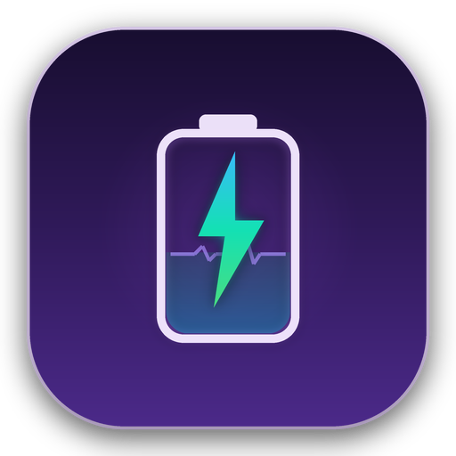
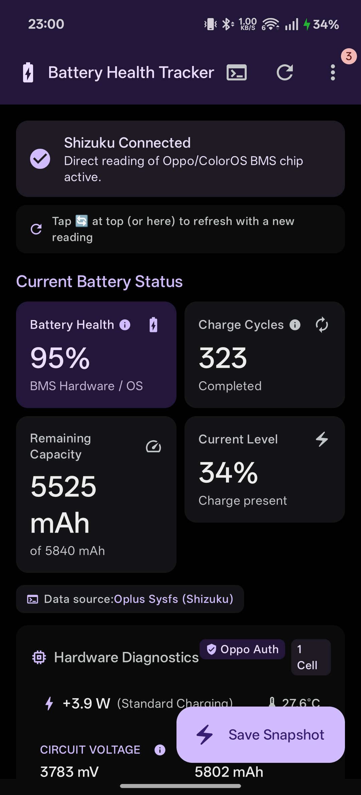
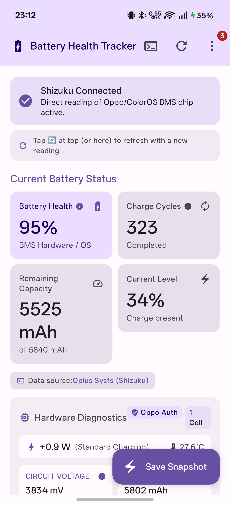
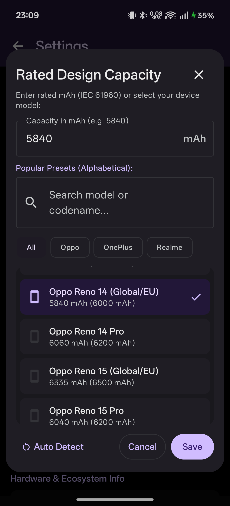
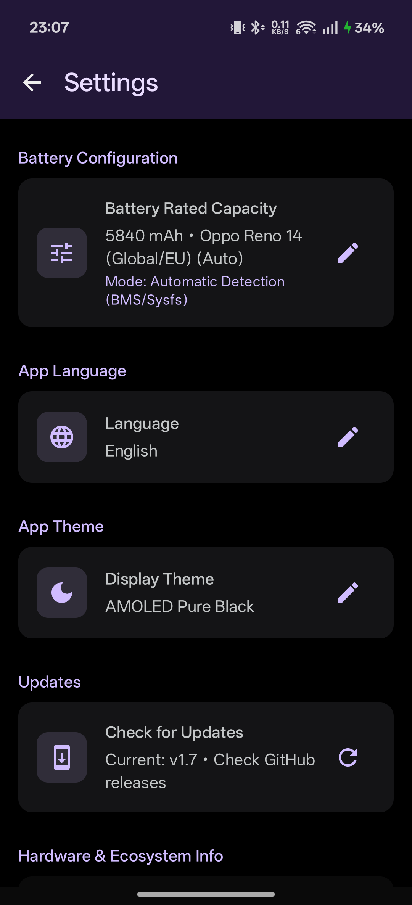
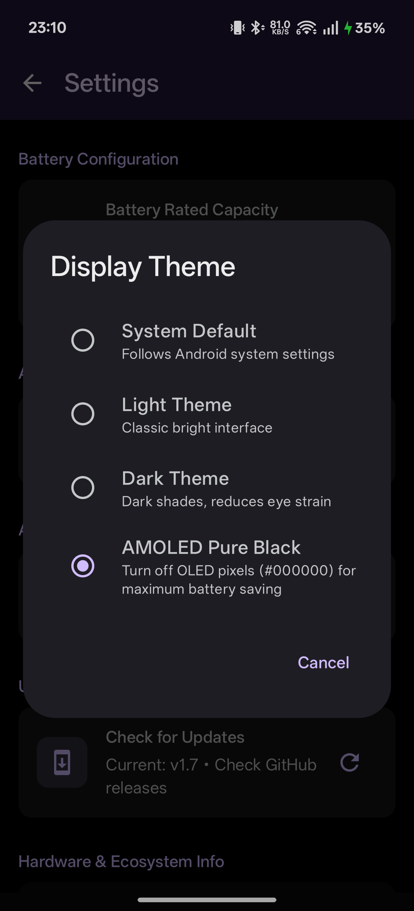
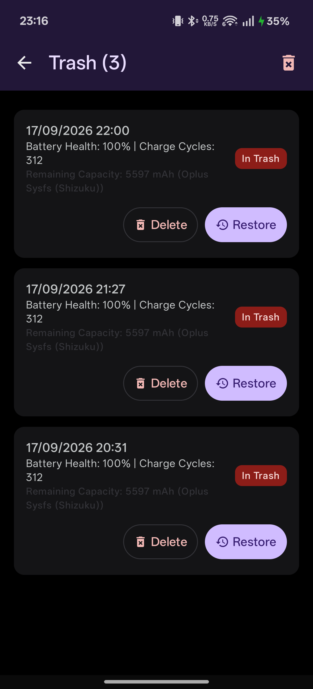

  

<h1 align="center">Battery Health Tracker (Community Edition)</h1>

  <b>Accurate battery health, cycle counts, live power streaming, and hardware degradation telemetry for Oppo, OnePlus, Realme, and Samsung Galaxy devices. Powered by Shizuku.</b>

  
  
  
  
  
  
  
  
  

---

## 📌 Overview

On modern Android devices, the operating system abstracts and smooths critical battery health metrics. Standard Android battery APIs typically return coarse percentage estimates, rounded cycle counts, or hide physical health statistics behind manufacturer service menus.

**Battery Health Tracker (Community Edition)** bridges this gap. By utilizing **[Shizuku](https://shizuku.rikka.app/)** to execute elevated unprivileged shell transactions (no root required), the application directly queries hardware Battery Management System (BMS) controllers and physical fuel-gauge ICs.

This delivers accurate, real-time electrochemical diagnostic data: true State of Health (SOH), non-volatile hardware cycle counts, genuine Samsung EFS wear metrics, cell temperature, and live power wattage streaming.

> [!NOTE]
> **📦 Community Edition Note:**  
> This public release focuses on core battery health tracking, home screen glanceable widgets, genuine cycle counting, Samsung Galaxy EFS calibration, and multi-language support. Deep kernel diagnostics, continuous 1 Hz charging profilers, and advanced internal resistance calculations are reserved for upcoming dedicated releases.

---

## 📸 Screenshots

<table align="center">
  <tr>
    <td align="center" width="33%"><b>AMOLED Pure Black</b></td>
    <td align="center" width="33%"><b>Light Theme</b></td>
    <td align="center" width="33%"><b>Device Presets & Rated mAh</b></td>
  </tr>
  <tr>
    <td></td>
    <td></td>
    <td></td>
  </tr>
  <tr>
    <td align="center" width="33%"><b>Settings</b></td>
    <td align="center" width="33%"><b>Theme Settings</b></td>
    <td align="center" width="33%"><b>Trash & Snapshot Bin</b></td>
  </tr>
  <tr>
    <td></td>
    <td></td>
    <td></td>
  </tr>
</table>

---

## ✨ Key Features

### 🔬 Hardware-Level BMS Telemetry (via Shizuku)
- **Direct Fuel-Gauge Interrogation:** Reads physical telemetry directly from onboard BMS controllers with zero root permissions required.
- **True State of Health (SOH):** Real electrochemical capacity evaluated against nominal factory design specifications (IEC 61960).
- **Hardware Cycle Counter:** Reads non-volatile cycles tracked by the physical fuel-gauge IC (immune to OS wipes or factory resets).
- **Samsung EFS & ASOC Telemetry:** Decodes genuine battery wear from raw `mSavedBatteryUsage` and Absolute State of Charge (ASOC) nodes on One UI.

### 📊 Glanceable Home Screen Widgets
- **Live Battery Status Widget (3×2 / 4×2):** Real-time home screen monitoring showing live SOH %, non-volatile cycles, dynamic charging/discharging wattage (+ / - W), and cell temperature.
- **Minimalist Circular Gauge (1×1):** Compact, glanceable circular gauge focused purely on battery health.
- **Power Connection Sync:** Instant widget refresh whenever the charger is connected or disconnected.

### ⚡ Live Power Streaming & Animated Wattage Meter
- **Continuous Power Flow:** Live BMS voltage and milliampere stream during active app usage.
- **Visual Power Direction:** Real-time animated wattage display with dynamic color-coding for charging (+W) and discharging (-W).

### 🎨 Material 3 & Fluid 120 Hz AMOLED UI
- **Native 120 Hz Fluidity:** Screen refresh rate locking for maximum scroll smoothness on high-refresh-rate displays.
- **Pure Black AMOLED:** Optimized Dark, Light, and True AMOLED Pure Black (`#000000`) modes for zero OLED sub-pixel power draw.

### 🌐 Multilingual Support
- Fully localized in **English**, **Italian (Italiano)**, **Spanish (Español)**, **French (Français)**, and **German (Deutsch)**.

---

## 📱 Verified Hardware & OEM Compatibility Matrix

| Diagnostic Feature | OPlus Ecosystem (OnePlus / OPPO / Realme) | Samsung Galaxy (Smartphones & Tablets) | Standard Android 14+ (AOSP / Pixel / Others) |
| :--- | :---: | :---: | :---: |
| **True SOH & Usable Capacity** | ✅ Dynamic BMS fuel-gauge | ✅ Hardware Calibration & Battery HAL | ⚠️ Android 14 HAL (if exposed by OEM) |
| **Hardware Cycle Count** | ✅ Direct kernel fuel-gauge | ✅ Hardware sysfs & EFS (`mSavedBatteryUsage`) | ✅ Android HAL Cycle Counter |
| **Live Wattage & Power Direction** | ✅ Real-time BMS stream | ✅ Real-time BMS stream | ✅ Android BatteryManager stream |
| **Home Screen Widgets** | ✅ Supported | ✅ Supported | ✅ Supported |
| **Privilege Requirements** | Shizuku (UID 2000) | Shizuku (UID 2000) | Shizuku / Standard HAL |

> 📖 **Device Database:** Check our verified catalog of 40+ pre-configured devices: **[docs/device-compatibility.md](docs/device-compatibility.md)**  
> *(Manual rated capacity override is also supported in Settings for custom or unlisted models).*

---

## 📥 Download & Installation

1. **Download:** Get the latest official APK from [**GitHub Releases**](https://github.com/FrancescoMin/batteryhealthtracker/releases/latest).
2. **Install Shizuku:** Install [**Shizuku**](https://shizuku.rikka.app/) from Google Play or GitHub and start it via Wireless Debugging or ADB.
3. **Launch & Authorize:** Open Battery Health Tracker and grant Shizuku permission when prompted.

> 💡 **Need help with Shizuku on ColorOS, OxygenOS, or Realme UI?**  
> Check our step-by-step setup guide: **[OPPO_REALME_ONEPLUS_SHIZUKU_GUIDE.md](OPPO_REALME_ONEPLUS_SHIZUKU_GUIDE.md)**

---

## 🔒 Privacy, Security & Permissions

- **100% Offline & Private:** Zero background analytics, zero remote telemetry trackers, zero advertising SDKs. No personal or battery data ever leaves your device.
- **Local Notifications (`POST_NOTIFICATIONS`):** Used strictly on-device for local sampling receipts and critical overheat alerts (> 42°C). Never used for background tracking or advertising.
- **Local Storage Only:** All measurements and logs are stored exclusively in your local on-device SQLite database.

---

## 🤝 Feedback & Device Compatibility Reports

Contributions of device test reports, compatibility verification, and translations are warmly welcome!
- If you test the app on a new device, please submit a report using our [**Device Compatibility Report Form**](https://github.com/FrancescoMin/batteryhealthtracker/issues).
- Encounter a bug or have a suggestion? Open an issue in our [**GitHub Issues**](https://github.com/FrancescoMin/batteryhealthtracker/issues).

---

## ⚖️ Disclaimer & Accuracy Notice

Battery Health Tracker is an independent diagnostic utility for monitoring and personal reference.
- **Non-Official:** This project is not affiliated with, endorsed by, or certified by Oppo, OnePlus, Realme, Samsung, or BBK Electronics.
- **Sensor Tolerances:** Telemetry is read directly from onboard sensors and fuel-gauge registers via elevated shell. Reported metrics may fluctuate depending on operating temperature, OEM firmware revisions, and sensor calibration.

---

## 📄 License

Copyright © 2025-2026 **FrancescoMin** (@FrancescoMin). All Rights Reserved.

This software is distributed under a **Strict Proprietary License**. The compiled binary application is provided for private personal evaluation and reference.

**Strict Prohibitions:**
- 🚫 **No App Store Publication:** Uploading, hosting, or publishing binaries, APKs, or derivative works on Google Play Store, F-Droid, Amazon Appstore, or any other app store or marketplace is strictly prohibited.
- 🚫 **No Commercial Exploitation:** Any commercial use, monetization, paid services, or inclusion in paid software bundles is forbidden.
- 🚫 **No Reverse Engineering or Rebranding:** Decompilation, disassembly, reverse engineering, extracting algorithms, or creating rebranded clones is strictly forbidden.

For full legal terms and conditions, consult the [LICENSE](LICENSE) file.

---

  Built with ❤️ for Android enthusiasts, battery health purists, and the Shizuku community.

