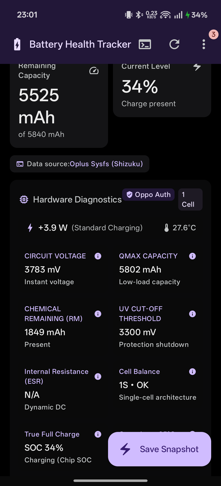
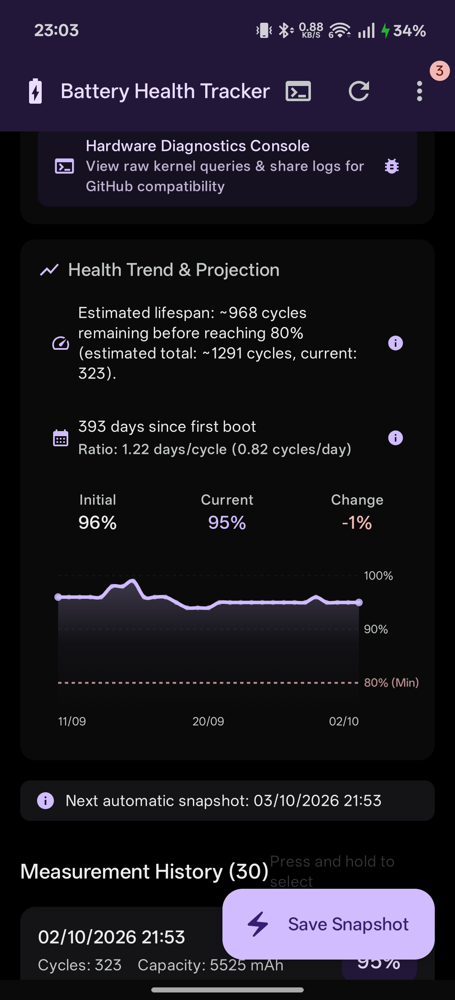
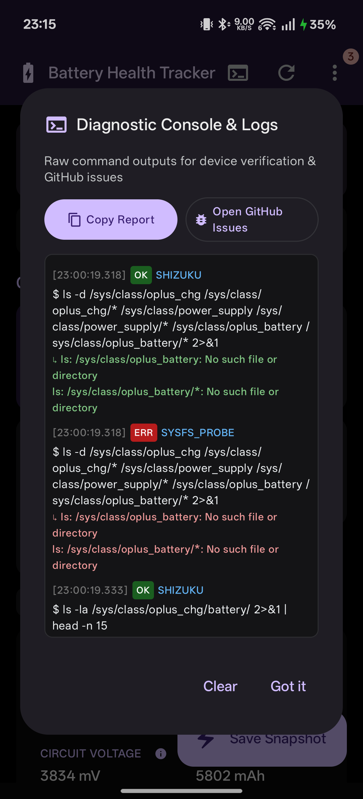

  

<h1 align="center">Battery Health Tracker</h1>

  <b>Advanced hardware-level battery health, BMS telemetry, and degradation tracker for Oppo, OnePlus, Realme, Samsung, and Nothing devices. Powered by Shizuku.</b>

  
  
  
  
  
  
  
  

---

## 📌 Overview

On modern Android devices, the operating system abstracts and smoothes critical battery health metrics. Standard Android battery APIs typically return coarse percentage estimates, rounded cycle counts, or hide physical health statistics behind manufacturer service menus.

**Battery Health Tracker** bridges this gap. By utilizing **[Shizuku](https://shizuku.rikka.app/)** to execute elevated unprivileged shell transactions (no root required), the application directly queries hardware Battery Management System (BMS) controllers and physical fuel-gauge ICs.

This delivers accurate, real-time electrochemical diagnostic data: true State of Health (SOH), non-volatile hardware cycle counts, internal cell resistance (ESR), cell temperature, thermal compensation, series cell balance, and live wattage.

> [!NOTE]
> **📱 Official Release & Distribution Hub:**  
> This repository is the official showcase and distribution channel for Battery Health Tracker compiled releases.  
> 📜 **Detailed Version History:** Check the **[CHANGELOG.md](CHANGELOG.md)** for a complete breakdown of features and enhancements across all releases.

---

## 📸 Screenshots

<table align="center">
  <tr>
    <td align="center" width="33%"><b>AMOLED Pure Black</b></td>
    <td align="center" width="33%"><b>Light Theme</b></td>
    <td align="center" width="33%"><b>Hardware Diagnostics</b></td>
  </tr>
  <tr>
    <td></td>
    <td></td>
    <td></td>
  </tr>
  <tr>
    <td align="center" width="33%"><b>Health Trend & Projection</b></td>
    <td align="center" width="33%"><b>Diagnostic Console</b></td>
    <td align="center" width="33%"><b>Device Presets & Rated mAh</b></td>
  </tr>
  <tr>
    <td></td>
    <td></td>
    <td></td>
  </tr>
  <tr>
    <td align="center" width="33%"><b>Settings & Updates</b></td>
    <td align="center" width="33%"><b>Theme Settings</b></td>
    <td align="center" width="33%"><b>Trash & Snapshot Bin</b></td>
  </tr>
  <tr>
    <td></td>
    <td></td>
    <td></td>
  </tr>
</table>

---

## ✨ Key Features

### 🔬 Hardware-Level BMS Telemetry (via Shizuku)
- **Direct Fuel-Gauge Interrogation:** Reads physical telemetry directly from onboard BMS controllers with zero root permissions required.
- **True State of Health (SOH):** Real electrochemical capacity evaluated against nominal factory design specifications.
- **Hardware Cycle Counter:** Reads non-volatile cycles tracked by the physical fuel-gauge IC (immune to OS wipes or battery stat resets).
- **Dual-Cell Architecture Support:** Real-time individual cell voltage monitoring and series balance tracking for dual-cell high-speed charging devices.

### ⚡ True Full Charge Detection
- **CC/CV Saturation Tracking:** Distinguishes between the display "100%" (often end of Constant Current phase) and **True Full Charge** when Constant Voltage current tapers to cutoff.

### 🌡️ Thermal Capacity Normalization
- **Standardized Capacity Evaluation:** Normalizes capacity calculations across thermal swings to eliminate seasonal capacity variations between winter and summer.

### 📈 Internal Resistance (ESR)
- **Dynamic Impedance Calculation:** Estimates real-time cell internal resistance ($m\Omega$) across active dynamic load steps, providing early warning for cell aging.

### 📊 Health Trends & Projections
- **Interactive SOH Chart:** Visual cubic spline trend canvas with 100%, 90%, and 80% industrial replacement threshold lines.
- **Cycle Life Projection:** Mathematical projections estimating remaining cycle life before reaching replacement thresholds based on historical wear rate.
- **Safe History Management:** Multi-select deletion, persistent Trash bin, batch restoration, and bidirectional CSV/JSON backup and export.

### ⏰ Configurable Background Work Scheduler
- **Customizable Intervals:** Select between 24-hour, 2-day, or 7-day periodic snapshots via Android WorkManager.
- **Material 3 TimePicker:** Choose the exact time of day for scheduled background measurements to prevent nighttime wakeups.

### 📱 Multi-OEM Compatibility & Advanced Samsung Telemetry
- **Wide OEM Coverage:** Built-in battery specifications for 40+ Oppo, Realme, and OnePlus models, plus Samsung Galaxy flagships (S25, S24, S23, S22, Z Fold/Flip, Tab series) and Nothing / CMF devices.
- **Samsung Hardware Telemetry:** Decodes raw chemical degradation from Samsung fuel-gauge calibration blocks, prioritizing molecular cell aging over smoothed system metrics.

### 📊 Interactive Home Screen Widgets
- **Detailed Battery Widget:** Real-time home screen monitoring showing live SOH %, hardware cycle count, dynamic wattage, and cell temperature.
- **Minimalist Gauge Widget:** Compact, glanceable circular gauge focusing purely on battery State of Health.
- **Power Event Auto-Refresh:** Automatically synchronizes and updates widget telemetry on charger plug and unplug events.

### ⚡ Live Power Streaming & Dynamic Wattage Meter
- **Real-Time Continuous Power Flow:** Live voltage and current stream during active app usage with color-coded power indicators.

### 🔔 Smart Notifications & Thermal Protection
- **Snapshot Receipts:** Confirmation notifications for manual saves, scheduled background logs, and 100% charger unplug events.
- **Overheat Alarm:** High-priority safety alert when battery temperature exceeds 42°C during high-speed charging or heavy workloads.

### 🚀 120 Hz Fluid UI & Themes
- **Fluid Performance:** Zero-allocation Composables locked to 120 Hz on supported high-refresh-rate displays.
- **4 Themes:** System Default, Light, Dark, and AMOLED Pure Black (`#000000`) for zero OLED sub-pixel power draw.

### 💻 Built-in Diagnostic Console
- **Real-Time Shell Inspector:** Live log of BMS queries with exit codes and fallback paths.
- **1-Click Bug Reporting:** Instant Markdown generation ready to share or paste into GitHub Issues.

### 🌐 Multilingual Support
- Fully localized in **English**, **Italian (Italiano)**, **Spanish (Español)**, **French (Français)**, and **German (Deutsch)**.

---

## 📱 Verified Hardware & OEM Compatibility Matrix

| Diagnostic Feature | OPlus Ecosystem (OnePlus / OPPO / Realme) | Samsung Galaxy (Smartphones & Tablets) | Standard Android 14+ (AOSP / Pixel / Others) |
| :--- | :---: | :---: | :---: |
| **True SOH & Usable Capacity** | ✅ Dynamic BMS fuel-gauge | ✅ Hardware Calibration & Battery HAL | ⚠️ Android 14 HAL (if exposed by OEM) |
| **Hardware Cycle Count** | ✅ Direct kernel fuel-gauge | ✅ Hardware sysfs & EFS | ✅ Android HAL Cycle Counter |
| **Individual Dual-Cell Voltages** | ✅ Serial 2S SuperVOOC | ⚠️ N/A or Asymmetric Dual EFS | ❌ Unsupported by standard API |
| **Internal Resistance (ESR)** | ✅ Dynamic step sampling | ✅ Dynamic step sampling | ⚠️ Basic approximation |
| **Privilege Requirements** | Shizuku (UID 2000) | Shizuku (UID 2000) | Shizuku / Standard HAL |

> 📖 **Device Database:** Check our verified catalog of 40+ pre-configured devices: **[docs/device-compatibility.md](docs/device-compatibility.md)**  
> *(Manual rated capacity override is also supported in Settings for custom or unlisted models).*

---

## 📥 Download & Installation

1. **Download:** Get the latest official APK from [**GitHub Releases**](https://github.com/FrancescoMin/batteryhealthtracker/releases/latest).
2. **Install Shizuku:** Install [**Shizuku**](https://shizuku.rikka.app/) from Google Play or GitHub and start it via Wireless Debugging or ADB.
3. **Launch & Authorize:** Open Battery Health Tracker and grant Shizuku permission when prompted.

> 💡 **Need help with Shizuku on ColorOS, OxygenOS, or Realme UI?**  
> Check our step-by-step setup guide: **[OPPO_REALME_ONEPLUS_SHIZUKU_GUIDE.md](OPPO_REALME_ONEPLUS_SHIZUKU_GUIDE.md)**

---

## 🔒 Privacy, Security & Permissions

- **Transparent Network Usage (`INTERNET`):** Used exclusively for the manual in-app update check against official public GitHub Releases (`api.github.com`). Zero background analytics, zero telemetry trackers, zero personal data leaves your device.
- **Transparent Notifications (`POST_NOTIFICATIONS`):** Used strictly for local on-device sampling receipts and critical battery overheat alarms (> 42°C). Never used for marketing or background telemetry.
- **Zero Trackers / Telemetry:** No Google Analytics, Firebase, Crashlytics, or third-party advertising SDKs.
- **Local Storage Only:** Historical measurements are stored in a local on-device SQLite database.

---

## 🤝 Feedback & Device Compatibility Reports

Contributions of device test reports, compatibility verification, and translations are warmly welcome!
- If you test the app on a new device, please submit a report using our [**Device Compatibility Report Form**](https://github.com/FrancescoMin/batteryhealthtracker/issues).
- Encounter a bug or have a suggestion? Open an issue in our [**GitHub Issues**](https://github.com/FrancescoMin/batteryhealthtracker/issues).

---

## ⚖️ Disclaimer & Accuracy Notice

Battery Health Tracker is an independent diagnostic utility for monitoring and personal reference.
- **Non-Official:** This project is not affiliated with, endorsed by, or certified by Oppo, OnePlus, Realme, Samsung, or BBK Electronics.
- **Sensor Tolerances:** Telemetry is read directly from onboard sensors and fuel-gauge registers via elevated shell. Reported metrics may fluctuate depending on operating temperature, OEM firmware revisions, and sensor calibration.

---

## 📄 License

Copyright © 2025-2026 **FrancescoMin** (@FrancescoMin). All Rights Reserved.

This software is distributed under a **Strict Proprietary License**. The compiled binary application is provided for private personal evaluation and reference.

**Strict Prohibitions:**
- 🚫 **No App Store Publication:** Uploading, hosting, or publishing binaries, APKs, or derivative works on Google Play Store, F-Droid, Amazon Appstore, or any other app store or marketplace is strictly prohibited.
- 🚫 **No Commercial Exploitation:** Any commercial use, monetization, paid services, or inclusion in paid software bundles is forbidden.
- 🚫 **No Reverse Engineering or Rebranding:** Decompilation, disassembly, reverse engineering, extracting algorithms, or creating rebranded clones is strictly forbidden.

For full legal terms and conditions, consult the [LICENSE](LICENSE) file.

---

  Built with ❤️ for Android enthusiasts, battery health purists, and the Shizuku community.

